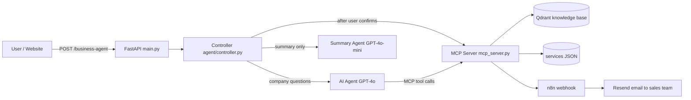

# MoinSystems AI Business Assistant (Round 9: MCP)

An AI lead-capture assistant for MoinSystems. It answers short questions about the company using tools exposed by an **MCP (Model Context Protocol) server**, collects a visitor's contact details, and — only after the user confirms — saves the lead through an n8n workflow that emails the sales team.

This project is the deliverable for **Round 9 — MCP** of the AI Engineer Internship Program: *a small MCP server exposing useful tools, connected to the AI application, with a documented flow from user request to tool execution.*

---

## 1. Why MCP?

Before MCP, every AI application had to hard-wire its own integrations: custom code for each tool, each data source, each model. Adding a new capability meant changing the application itself.

MCP is an open standard that fixes this by separating two roles:

| Role | What it does | In this project |
|---|---|---|
| **MCP Server** | Exposes capabilities (tools, resources, prompts) in a standard, self-describing format | `mcp_server.py` |
| **MCP Client** | Connects to a server, discovers what it offers, and invokes it | `agent/controller.py` (FastMCP client + pydantic-ai `MCPToolset`) |

Benefits seen in this project:

- **Discovery:** the AI application does not hard-code tool names or schemas. It asks the server what is available.
- **Separation of concerns:** tool logic (Qdrant, JSON files, n8n) lives in the server; conversation logic lives in the app.
- **Reusability:** the same server could be used by another MCP-compatible client without code changes.
- **Controlled exposure:** the client decides which of the server's tools the AI model is allowed to see (see Security).

---

## 2. Architecture



### Project structure

```
9.MCP/
├── main.py                  # FastAPI app, /business-agent endpoint, session memory
├── mcp_server.py            # MCP server: tools, resource, prompt
├── config.py                # Qdrant settings (read from .env)
├── test_mcp.py              # Lists the server's tools, resources and prompts
├── agent/
│   ├── controller.py        # MCP client, AI agent, conversation flow, human-in-the-loop
│   └── prompt.py            # System prompt for the AI agent
├── data/
│   └── moinsystems_services.json
├── n8n_files/
│   └── leads.csv            # Leads saved locally by n8n
├── .env                     # Secrets (never committed)
└── .gitignore
```

---

## 3. What the MCP server exposes

MCP has three kinds of capabilities. This server provides all three.

### Tools (actions the client can invoke)

| Tool | Purpose | Visible to the AI model? |
|---|---|---|
| `rag_search(query)` | Embeds the question (OpenAI `text-embedding-3-small`) and returns the top 3 matching chunks from the Qdrant collection `moinsystems_knowledge` | Yes |
| `get_service_info(service_name)` | Looks up a service or company/contact info in `data/moinsystems_services.json` | Yes |
| `save_lead(name, email, contact, service, project_summary, conversation_summary, ...)` | Sends the lead to the n8n webhook, which emails the sales team | **No** — called only by code after user confirmation |
| `list_saved_lead(limit)` | Reads recent leads from the local CSV | **No** — contains private customer data |

### Resource (read-only data)

| URI | Content |
|---|---|
| `moinsystems://services` | The full services data file as text |

### Prompt (reusable template)

| Name | Purpose |
|---|---|
| `lead_summary_prompt(conversation)` | Template that turns a chat into a short sales lead note |

> Run `python test_mcp.py` to see the server list all of these.

---

## 4. Flow: from user request to tool execution

The application uses two paths. The AI model is only used for answering company questions. Lead saving is controlled by code.

### Path A: Company question (AI + MCP tools)

Example: *"What services do you offer?"*

1. The user sends `POST /business-agent` with `message` and `session_id`.
2. `main.py` loads the session history (last 10 messages) and calls `agent_controller`.
3. The controller detects a direct company question (`is_info_question`).
4. The AI agent (GPT-4o) is run. Through the MCP client it **discovers** the tools it is allowed to see: `rag_search` and `get_service_info`.
5. The model decides which tool to call. The MCP client sends the request to the MCP server (stdio).
6. The MCP server executes the tool (e.g. Qdrant search) and returns the result.
7. The model writes an answer from the tool result. The controller shortens it to at most 2 sentences and appends a request for the missing Name / Email / Contact.
8. The response is returned as `{"response": "..."}` and stored in session history.

### Path B: Lead capture (code-controlled, human-in-the-loop)

Example: *"I need a website for my agency"* → *"Ali, ali@mail.com, 0300123456"* → *"Yes"*

1. **Project message:** the controller replies with a fixed message asking for Name, Email and Contact. The AI model is not involved.
2. **Details message:** the controller extracts name, email and phone with regular expressions and asks: *"I have your details (...). Should I save this lead?"*
3. **Corrections:** if the user sends a new email or phone instead of yes/no, the controller shows the updated details and asks again.
4. **User confirms ("Yes" / "Haan"):** the controller calls the Summary Agent (GPT-4o-mini, no tools) to produce a short service name and natural summaries from the conversation.
5. The controller calls `save_lead` **directly** on the MCP server.
6. The MCP server POSTs the payload to the n8n webhook.
7. n8n sends the email (Resend) with subject `New <Service> Lead — MoinSystems AI` and stores the lead in `leads.csv`.
8. The tool's result message is returned to the user.

If the user says "No", nothing is saved.

---

## 5. Security and trust decisions

Exposing tools to an AI model is a trust decision. These are the controls used here:

1. **Tool allowlist for the AI.** The agent can only see `rag_search` and `get_service_info` (read-only knowledge tools). Everything else is hidden by `tool_filter` in `controller.py`.
2. **Sensitive action is not exposed to the model.** `save_lead` is never visible to the AI. This prevents the model from saving leads, or claiming it did, without approval.
3. **Explicit human confirmation.** The lead is saved only after the system showed the collected details and the user answered "Yes".
4. **Private data protected.** `list_saved_lead` is hidden from the model, so a user cannot ask the chatbot to reveal other customers' details.
5. **Secrets in environment variables.** API keys and the webhook URL live in `.env` (excluded by `.gitignore`), not in code.
6. **Safe stdio logging.** In stdio transport, stdout is reserved for MCP messages. Debug output is written to `stderr` only.
7. **Bounded AI output.** Replies are limited to 2 short sentences, and the tool descriptions state that pricing must not be guaranteed.
8. **Timeouts and error handling.** The webhook call has a 15-second timeout, and tool errors are returned as readable messages instead of crashing the server.
9. **Absolute paths.** The server resolves its data and `.env` paths from its own location, so it works regardless of the working directory.

---

## 6. Setup and run

### Requirements

- Python 3.11+
- A Qdrant collection named `moinsystems_knowledge` (embeddings: `text-embedding-3-small`, 1536 dimensions)
- An n8n workflow with a Webhook trigger (**Active**, using the production URL) that sends the email
- An OpenAI API key

### Install

```bash
pip install fastapi uvicorn pydantic-ai fastmcp mcp qdrant-client openai httpx python-dotenv
```

### Environment variables (`.env`)

```
OPENAI_API_KEY=sk-...
QDRANT_URL=https://your-qdrant-url
QDRANT_API_KEY=your-qdrant-key
N8N_WEBHOOK_URL=http://localhost:5678/webhook/your-webhook-id
```

Use the **production** webhook URL (`/webhook/...`), not `/webhook-test/...`.

### Verify the MCP server

```bash
python test_mcp.py
```

Expected output:

```
TOOLS: ['rag_search', 'get_service_info', 'save_lead', 'list_saved_lead']
RESOURCES: ['moinsystems://services']
PROMPTS: ['lead_summary_prompt']
```

### Start the API

```bash
python -m uvicorn main:app
```

Open `http://127.0.0.1:8000/docs` for the Swagger UI. The MCP server is started automatically as a subprocess when the API starts.

> On Windows, avoid `--reload`: it restarts the process repeatedly and can interfere with the MCP subprocess.

---

## 7. API

### `POST /business-agent`

Request:

```json
{
  "message": "I need a website for my agency",
  "session_id": "user_1"
}
```

Response:

```json
{
  "response": "That sounds like a great project! To connect you with our sales team, could you please share your Name, Email, and Contact number?"
}
```

Use the **same `session_id`** for one conversation. Session memory is kept in the server's memory and resets on restart.

### Example conversation

| # | User | Assistant |
|---|---|---|
| 1 | I need a website for my agency | That sounds like a great project! ... share your Name, Email, and Contact number? |
| 2 | Ali, ali@mail.com, 0300123456 | I have your details (Name: Ali, ...). Should I save this lead for our team? |
| 3 | Yes | Thank you! Your details are saved (...). Our sales team will contact you shortly. |

---

## 8. Testing checklist

| Test | Expected result |
|---|---|
| `python test_mcp.py` | Lists 4 tools, 1 resource, 1 prompt |
| `hi` | Short friendly greeting |
| `what services do you offer?` | Max 2 short sentences, then asks for contact details |
| `show me recent leads` | No customer data revealed |
| Project message, then details, then `Yes` | Lead saved, email received with correct subject and summaries |
| Details, then `No` | Nothing saved |
| Details, then a corrected email | Updated details shown, asks to confirm again |

---

## 9. Known limitations

- **Session memory is in-process.** It resets when the server restarts. A database or Redis would be needed for production.
- **No authentication on the API.** CORS is open (`*`) for development and should be restricted in production.
- **Rule-based extraction.** Name, email and phone are extracted with regular expressions and keyword rules, so unusual formats may be missed.
- **`lead_summary_prompt` is exposed as a demonstration of MCP prompts.** The summary agent in `controller.py` uses equivalent instructions defined locally.
- **Local n8n.** The webhook points to `localhost`, so the app must run on the same machine as n8n unless n8n is deployed.

---

## 10. Round 9 requirements coverage

| Requirement | Where it is covered |
|---|---|
| Why MCP exists | Section 1 |
| MCP clients and servers | Sections 1 and 2 |
| Tools, resources and prompts | Section 3 |
| Discovering and invoking capabilities | Section 4 (Path A), `test_mcp.py` |
| Building a small MCP server | `mcp_server.py` |
| Connecting an AI application to MCP tools | `agent/controller.py` |
| Security and trust considerations | Section 5 |
| Documented flow from request to tool execution | Section 4 |